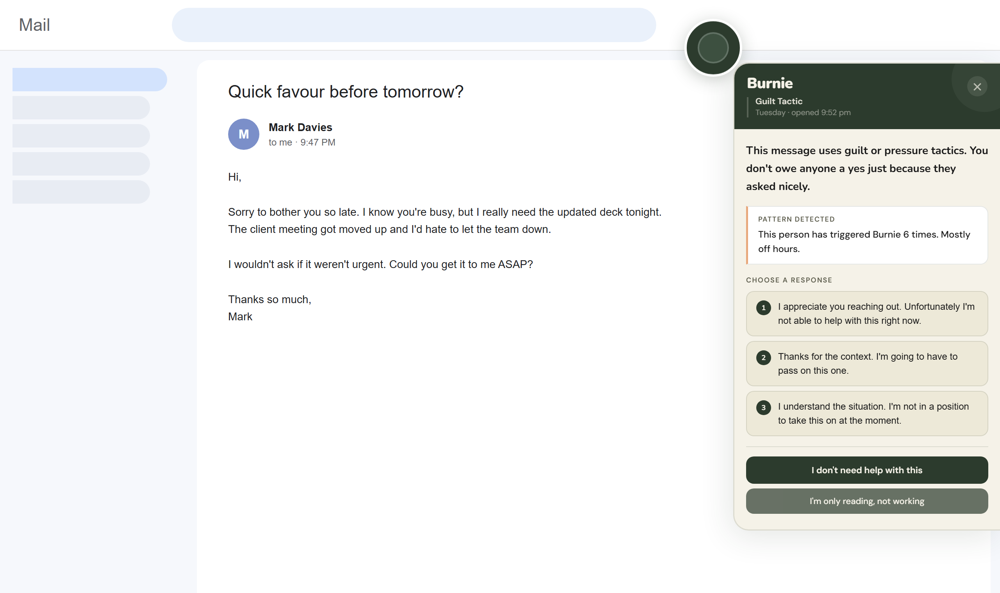
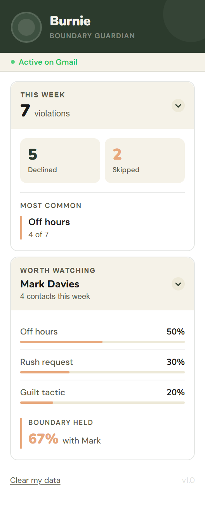

<p align="center">
  
</p>

<h1 align="center">Burnie</h1>
<p align="center"><b>Your personal boundary enforcer for Gmail.</b><br>
Burnie nudges you before you say yes to things you shouldn't.</p>

---

## What it does

When you open an email in Gmail, Burnie reads it and checks for common boundary-crossing patterns. If it finds one, a small sidebar slides in with:

- **A gentle nudge** that names what's going on ("This message uses guilt or pressure tactics…")
- **Pattern memory**: if a sender keeps doing this, Burnie tells you ("This person has triggered Burnie 6 times. Mostly off hours.")
- **Three ready-to-send responses** that hold your boundary politely. One click copies a response to your clipboard.



### What Burnie detects

| Pattern | Example trigger |
|---|---|
| **Off hours** | Email opened before 8am or after 7pm |
| **Weekend** | Opened on a weekend, or mentions "this weekend", "by Monday morning"… |
| **Rush request** | "ASAP", "urgent", "end of day", "by tonight"… |
| **Guilt tactic** | "hate to ask", "I wouldn't ask if", "just this once"… |
| **Overload** | "can you also", "one more thing", "on top of that"… |
| **Meeting push** | "quick call", "are you available", "can we meet"… |

### Weekly stats

Click the Burnie icon in your toolbar to see your week: how many boundary-crossing requests you got, how many you declined, the most common type, and which sender is worth watching.

<p align="center"></p>

> Screenshots use sample data.

## Privacy

- Everything runs **locally in your browser**. There is no server, no account and no analytics.
- Burnie only runs on `mail.google.com`.
- Sender addresses are **hashed** before anything is stored. Your stats live in Chrome's local storage, and **Clear my data** in the popup wipes them.

## Try it (about 1 minute)

Burnie isn't on the Chrome Web Store yet, so you install it in developer mode:

1. **Download** this repo: click the green **Code** button above, then **Download ZIP**, and unzip it.
2. Open Chrome and go to **`chrome://extensions`**.
3. Turn on **Developer mode** (toggle in the top-right corner).
4. Click **Load unpacked** and select the unzipped folder (the one that contains `manifest.json`).
5. Open [Gmail](https://mail.google.com) (refresh it if it was already open) and open an email.

To see Burnie in action, open (or send yourself) an email like:

> *"I really need this ASAP. I wouldn't ask if it weren't important. Can you also send the notes?"*

Tip: pin Burnie from the puzzle-piece menu in the toolbar so the stats popup is one click away.

It also works in other Chromium browsers (Edge, Brave, Arc) through their own extensions page.

## Project structure

```
manifest.json   Chrome extension config (Manifest V3)
content.js      Watches Gmail navigation and shows the sidebar
extractor.js    Reads the open email and detects violations
templates.js    Nudges and response templates for each violation type
patterns.js     Sender history and weekly insights
storage.js      Local storage (interactions, sender profiles, settings)
popup.html/js   Toolbar popup with weekly stats
sidebar.css     Sidebar styles
```

## Status

Early prototype (v1.0). Feedback welcome!
